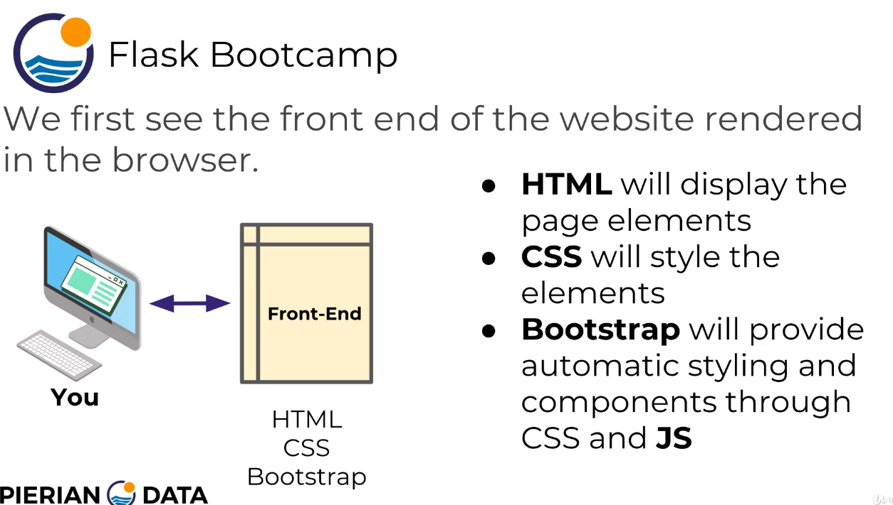
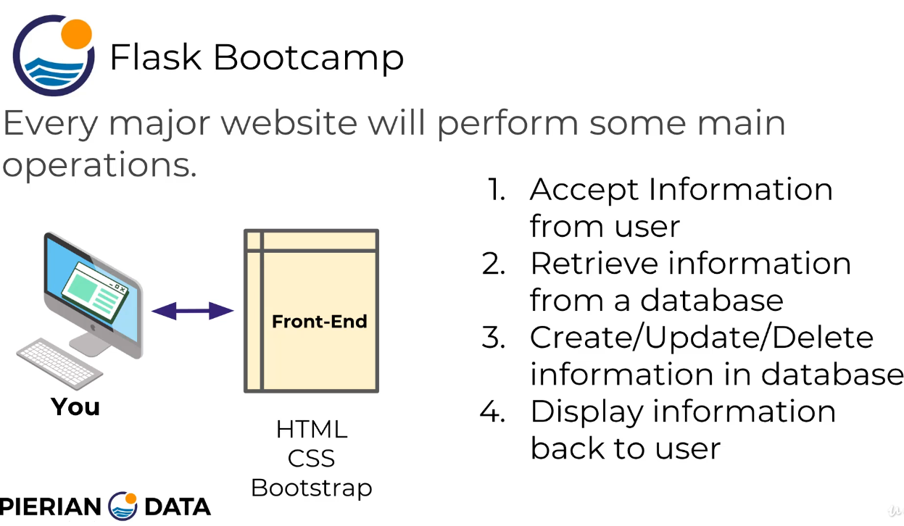
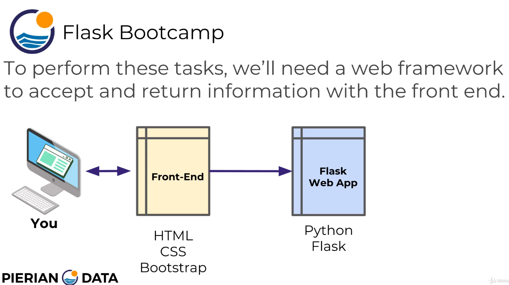
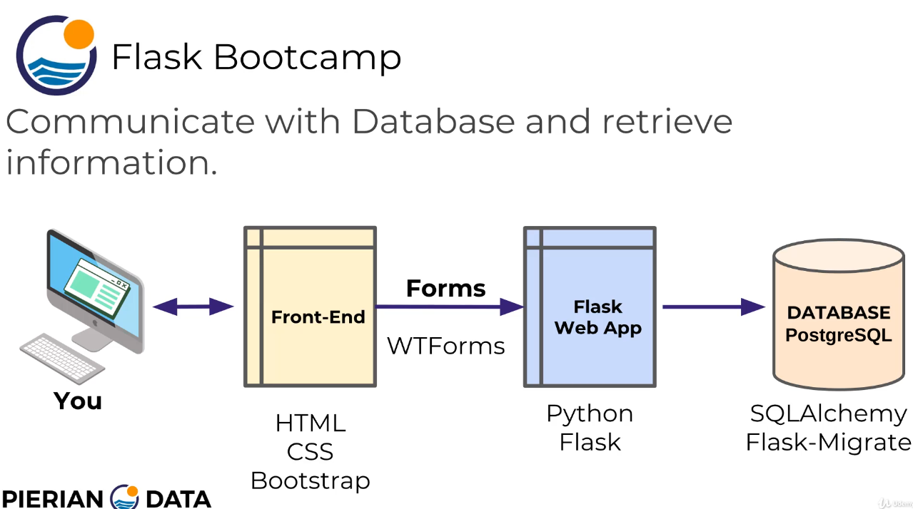
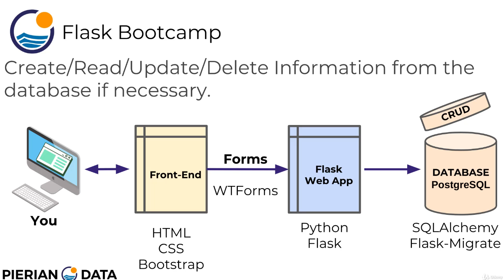
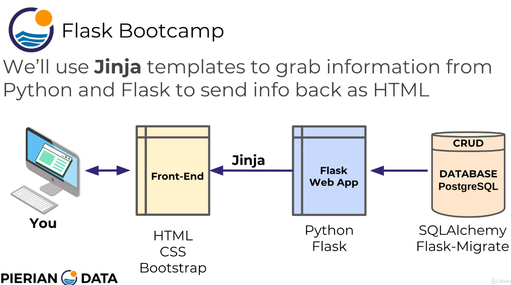
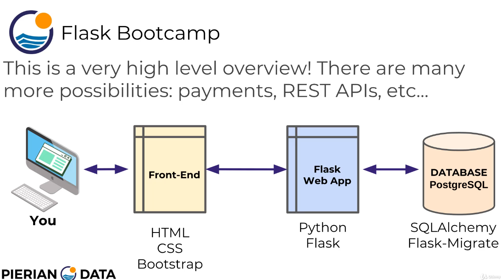
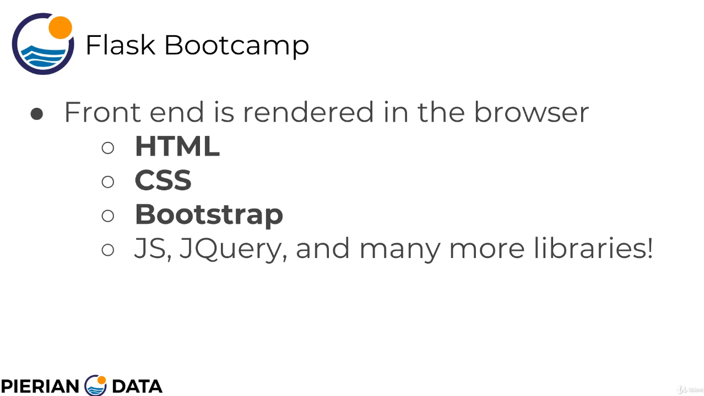
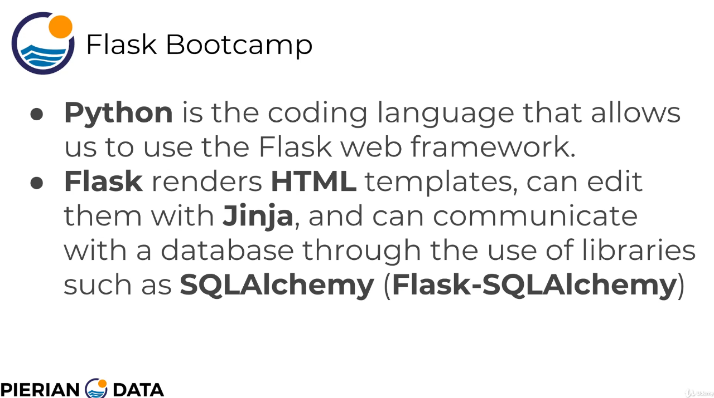

# Flask

## Table des matières
- 1. [Pourquoi Flask ?](#1-pourquoi-flask-)
- 2. [Préparation de l'environnement](#2-préparation-de-lenvironnement)
- 3. [Comment le site web de Flask fonctionne](#3-comment-le-site-web-de-flask-fonctionne)
- Section 10. [Bases de données SQL avec Flask](#section-10-bases-de-données-sql-avec-flask)
  - 10.1. [Flask et les bases de données](#101-flask-et-les-bases-de-données)
  - 10.2. [Fichier dev/`basic.py`](#102-fichier-devbasicpy)
  - 10.3. [Fichier dev/`setupdatabase.py`](#103-fichier-devsetupdatabasepy)

---

## 1. Pourquoi Flask ?

* Micro-framework Python
* Simple à prendre en main
* Extensible avec des plugins
    * Flask-SQLAlchemy
    * Flask-Login
  
##### [Table des matières](#table-des-matières)

---

## 2. Préparation de l'environnement

```bash
$ cd Projets/Flask-Bootcamp-master/dev
$ python -m venv .venv
$ source .venv/bin/activate
$ python -m pip install --upgrade pip
$ python -m pip install -r requirements.txt
$ python -m pip check
```

##### [Table des matières](#table-des-matières)

---

## 3. Comment le site web de Flask fonctionne



<br>

---



<br>

---



<br>

---



<br>

---



<br>

---



<br>

---



<br>

---


<br>

---



<br>

---



<br>

##### [Table des matières](#table-des-matières)

---

## 4. HTML

##### [Table des matières](#table-des-matières)

---

## Section 10. Bases de données SQL avec Flask
### 10.1. Flask et les bases de données

```bash
$ sudo apt install sqlite3
$ sqlite3 --version
$ 3.46.1 2024-08-13 09:16:08 c9c2ab54ba1f5f46360f1b4f35d849cd3f080e6fc2b6c60e91b16c63f69aalt1 (64-bit)

```

##### [Table des matières](#table-des-matières)

---

### 10.2. Fichier dev/`basic.py`

```python
import os
from flask import Flask
from flask_sqlalchemy import SQLAlchemy

basedir = os.path.abspath(os.path.dirname(__file__))

print(basedir)

app = Flask(__name__)

app.config["SQLALCHEMY_DATABASE_URI"] = "sqlite:///" + os.path.join(
    basedir, "data.sqlite"
)

app.config["SQLALCHEMY_TRACK_MODIFICATIONS"] = False

db = SQLAlchemy(app)

class Puppy(db.Model):

    __tablename__ = "puppies"

    id = db.Column(db.Integer, primary_key=True)
    name = db.Column(db.Text)
    age = db.Column(db.Integer)

    def __init__(self, name, age):
        self.name = name
        self.age = age

    def __repr__(self):
        return f"Puppy {self.name} is {self.age} years old"
```

##### [Table des matières](#table-des-matières)

---

### 10.3. Fichier dev/`setupdatabase.py`

```python
from basic import app, db, Puppy

with app.app_context():

    # Création du fichier data.sqlite et la table puppies
    db.create_all()

    sam = Puppy("Sammy", 3)
    frank = Puppy("Frankie", 4)

    # Les objets ne sont pas encore enregistrés
    print(sam.id)
    print(frank.id)

    # Ajout des objets à la session
    db.session.add_all([sam, frank])

    # Enregistrement dans la base de données
    db.session.commit()

    # Les identifiants sont maintenant attribués
    print(sam.id)
    print(frank.id)
```

##### [Table des matières](#table-des-matières)

---
